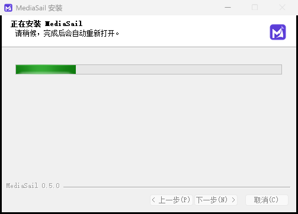

# MediaSail 本机真实升级记录 · 2026-10-15

结论：在 Windows 原生运行环境中，通过未修改的 0.4.3 软件更新窗口成功安装正式版 **0.5.0**，最终仍在 `D:\mediasail`。旧程序环境清除、正常重启、数据保留及再次检查更新均通过。本机未发现需要额外发行版本的安装缺陷，**没有发布 0.5.1**。

[正式版本与完整安装包](https://github.com/jerryrenjianxing-sys/MediaSail/releases/tag/v0.5.0)。安装包为 273,780,875 字节，SHA256 为 `13d2946e4e9bab7faa31d0714d73ad83401d44c3543c9c2aed5822138bc2f0d6`。

## 测试环境与首轮结论修正

本机 Windows 11，当前用户安装，原位置 `D:\mediasail`，数据目录沿用 `%LOCALAPPDATA%\ElectronEasel`。测试未替换 GitHub 下载源、修改更新元数据、手动覆盖程序或跳过校验。

首轮从 Codex 工具环境启动旧版，遇到旧网关启动失败，仍通过原更新窗口完成真实下载与安装；自动重新打开后发现 C 盘副本。随后用文件句柄的最终物理路径核对，确认工具进程读到了 Codex 的 LocalCache 私有视图，原生进程读到的是真实 AppData；两边的安装登记视图也不同。**原生登记本来就指向 D 盘 0.4.3**，“本机没有安装登记”仅在工具视图中成立。

这种隔离视图可以重定向 AppData 与 HKCU，私有文件优先于原生文件读取，符合微软的 [MSIX 文件与登记行为说明](https://learn.microsoft.com/en-us/windows/msix/desktop/desktop-to-uwp-behind-the-scenes)。因此首轮旁装与网关失败未被当作普通 Windows 启动的软件缺陷。

清理前分别保全两套数据现场，正常卸载本轮 C 盘副本，等待卸载器清理登记完毕，恢复 D 盘快捷方式。后续由已核验原生文件视图的临时维护进程启动 D 盘原版，使用它自己的检查、下载和安装按钮；没有补写原生安装登记。

## 备份边界

升级前完整复制并逐文件核验了 D 盘程序，85,845 个文件，5,206,208,390 字节；同时备份工具所见数据、更新缓存、登记和快捷方式。

发现重定向后，额外分别复制并核验原生数据与显式 LocalCache 私有目录。**原生独立快照是在首次 0.5.0 副本自动打开后取得，并非首次升级之前的原生快照**；原生 D 盘升级和清理前，该快照已完成。原生快照为 3,507 个普通文件、499,225,255 字节，另记录 6 个链接的目标，不跟随链接复制。没有把两套资料混合恢复，也没有用私有视图覆盖原生数据。

全部备份、原始日志、浏览器资料和逐文件清单留在本机程序目录外，不进入 GitHub。公开资料只有聚合结果和不含账号信息的截图。测试写出的旧连接描述文件已移入备份，工具现在能读取原生 0.5.0 的当前连接信息。临时维护进程和调试监听已关闭。

## 下载与安装实测

| 项目 | 结果 |
|---|---|
| 首轮原更新器检查 GitHub | 约 3.4 秒 |
| 首轮下载及校验总耗时 | 715.388 秒，约 11 分 55 秒 |
| 差量计划 | 254,272,473 字节，约完整包 93%；746 个范围请求，其中 692 个小于 100 KB |
| 差量失败 | `net::ERR_CONNECTION_CLOSED`，更新器自动回退全量；未人为改变下载行为 |
| 成功的完整包 | 273,780,875 字节；全量回退后约 139 秒下载完成 |
| 另已观察到的失败差量 | 至少 123,472,989 字节；因此两阶段安装包数据合计至少 397,253,864 字节 |
| 原生轮“下载”操作 | 复用上述已下载并重新校验的缓存，2.036 秒，新增安装包网络数据为 0 |
| 原生轮点击安装至自动重开 | 167.825 秒，约 2 分 48 秒 |
| 原生轮点击安装至服务就绪 | 175.106 秒，约 2 分 55 秒 |
| 后续两次启动至首页 | 1.636 秒、1.620 秒 |

时间来自更新日志和观察脚本。安装与重开由进程轮询观察，存在数秒采样误差；没有跳过真实卸载、解压或自动重启。传输数为更新器报告的安装包负载，失败差量只保留到中途观察值，**不是完整抓包总量**，不包括 HTTP 头和 blockmap 等元数据。网络条件为本机当时直接访问 GitHub，未控制带宽；不是不同网络的速度承诺。

## 清理与最终安装

| 项目 | 更新前 / 参考快照 | 最终 |
|---|---:|---:|
| 程序目录 | 5,206,208,390 字节 / 85,845 文件 | 837,922,271 字节 / 8,614 文件 |
| 原生更新缓存 | 2,061,356,105 字节（首轮后快照） | 548,131,105 字节 |
| 原生用户数据 | 499,225,255 字节（首轮后快照） | 约 542 MB，另计 |

程序目录减少 **4,368,286,119 字节，约 4.37 GB**。完整备份单独保留，占用另计，不能把程序缩减量当作包含备份后的整盘净释放量。

- 新版进程、原生安装登记、桌面快捷方式、开始菜单快捷方式均指向 `D:\mediasail`。
- 默认 C 盘位置无本轮副本，观察到的旧卸载器临时目录也已消失。
- `resources/runtime/node`、`ffmpeg`、`browsers` 均不存在；保留业务 Python 和 Playwright 私有驱动。
- 缓存中的两个安装包均为 0.5.0，旧 0.4.3 安装缓存已被当前安装器替换，当前差量更新所用缓存仍在。
- 没有通过大范围递归删除旧程序兜底，没有删除用户自行保存的安装包和历史 GitHub Release。

## 数据与重启核验

原生 D 盘升级后及连续两次正常重启后，保留文件核验均为 0 失败：画像模板 7 文件、素材 62 文件、成品区 4 文件、配置、旧 UI 备份均保留；6 个链接目标未改变。当前没有用户自建画像，因此不将模板保留冒充真实画像内容验收。

旧聊天仍保留在 UI 原始状态，1 条会话的内容摘要一致；`history-archive/0.5.0` 完成标记有效，归档清单文件校验全部通过。主题、草稿及旧状态键保留，账户显示缓存因页面刷新发生变化。AitoEarn 的本地草稿选择、任务记录和分区保留。

平台 Cookie 原有 **40 个唯一标识全部保留**，浏览器刷新后新增 6 个。23 个原标识的值或加密存储及到期时间发生更新，安全属性未改变；这与已观察到的工作台账户状态刷新同时发生，不将数据库逐字节变化误判为资料丢失。原生快照中的账户状态缓存均为未登录，AitoEarn 原有 Cookie 为 0；**本次不能宣称真实已登录账号或 AitoEarn 已登录状态验收**。

本地服务就绪且无网关依赖。画像、内容、账号列表、日历、选题、分析平台的只读接口均返回 200；连接首页、控制台、画像、内容库、技能方法、设置与聊天存档入口可打开，无页面脚本错误。退出时曾因工作台自动刷新出现正常任务提醒，选择继续运行并等待任务结束后退出，没有关闭提醒或强制结束任务。之后两次正常退出、重启与保存核验通过。

最终普通启动的 0.5.0 留在 D 盘运行，再次使用原更新窗口显示“当前已是最新版本”。没有重启电脑，没有以真实账号公开发布内容。0.5.1 仅为独立缺登记场景的草稿候选，未作为本次正式更新发布。

## 截图

聚合机器核验数据见 [summary.json](evidence/local-upgrade-2026-10-15/summary.json)。逐文件差异、Cookie 标识与值的摘要不公开。
