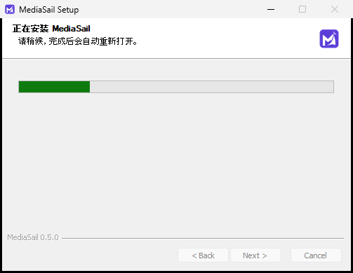

# MediaSail 0.5.0 验证记录

日期：2026-10-15（北京时间）。范围：外部 Agent 接替、业务能力保留、运行环境裁剪、旧程序清理升级。

## 已完成的本地隔离验证

- Node测试37项通过：业务/数据保留、跨端口状态、归档、缓存清理、更新和AitoEarn草稿行为。
- 后端隔离HTTP测试12项通过；5项既有业务离线自检通过。
- Skill辅助测试4项通过，含中文空格路径、无Node/网关、离线业务计算、manifest/tracker/review实际调用。
- 画像选择迁移边界6项通过；TypeScript与生产构建通过。
- 真实打包UI：125条旧会话完整保留、建档baseline-ready、画像独立选择、外部更新刷新与脏编辑保护、成品登记可见、设置历史/更新入口、重启换端口。
- 实际首页亮暗截图经视觉检查，保留原布局与主题动画。无真实账号登录或公开发布。
- 暂存区回归：旧完整包的OpenClaw、演示资源不会回流新manifest。
- 独立外部Agent仅凭复制说明，完成画像读取、原有review.py复盘计算、成品登记和经验回写。3帖互动总数375、reach合计4000，逐帖平均互动率9.5%、汇总加权9.375%，独立算术复核一致；未把小样本结果当作稳定规律。
- 补充打包验收通过：复制失败手动弹窗、完整Skill下载、停机定位资料、错误实例身份拒绝、重启换端口、自动更新提示关闭/托盘/重启/断网恢复、AitoEarn视图随横幅调整。测试未下载或安装模拟更新。

[实际界面验证JSON](evidence/lite-ui-0.5.0.json) · [知识整理](KNOWLEDGE-CURATION-0.5.0.md)

[独立Agent记录](evidence/external-agent-0.5.0.json) · [实际分析报告](evidence/external-agent-report-0.5.0.md) · [连接与横幅验收](evidence/agent-connection-0.5.0.json)

## 安装与发布验收

已发布：[MediaSail v0.5.0](https://github.com/jerryrenjianxing-sys/MediaSail/releases/tag/v0.5.0)。五个发布文件的GitHub服务器SHA-256与本地一致，更新索引SHA-512、版本和安装包大小检查通过；8个历史Release的资产ID、大小和校验值均保留。[资产记录](evidence/assets-0.5.0.json)

草稿候选的真实 **0.4.3 → 0.5.0** Windows安装升级通过，使用原安装包、实际NSIS `/S --updated --force-run`，没有模拟安装或跳过旧卸载器。[工作流](https://github.com/jerryrenjianxing-sys/MediaSail/actions/runs/38725734199) · [结果](evidence/upgrade-candidate-0.5.0.json)

- 实际观察到可视安装进度，安装成功后自动启动一次，保留中文空格自选安装目录。
- 旧独立Node、FFmpeg、浏览器目录消失；保留Playwright私有Node驱动，未将其当成独立Agent运行环境。
- 测试画像、素材、成品、分析快照、日历、配置、草稿、暗色主题、平台浏览器测试资料和AitoEarn测试cookie保留。旧聊天原始记录未变，存档完成。
- 新版业务服务就绪，旧聊天及内部Agent执行接口返回410。测试安装已正常卸载，`cleanedUp:true`。

| 指标（逻辑字节，十进制MB/GB） | 0.4.3 | 0.5.0 |
| --- | ---: | ---: |
| 完整安装包 | 1,787,005,875 B（1.787 GB） | 273,780,875 B（273.781 MB） |
| 候选测试中的实际程序目录 | 5,194,730,188 B | 837,922,271 B |
| 程序文件数 | 85,326 | 8,614 |

安装包减少约84.68%。候选升级释放程序逻辑空间 **4,356,807,917 B（约4.36 GB）**，不包含用户数据和缓存，也不等同文件系统分配空间。升级开始至重新观察到程序为406.590秒，至服务就绪413.562秒，包含卸载旧程序与安装新版及观测开销，不是纯解压耗时。

同一本机的单次独立启动样本：0.4.3约102.826秒，0.5.0为3.764秒（主页可见且实际`serviceReady:true`）。两次均新建测试数据，但系统/文件/杀毒缓存未控制，各仅一次，不构成普遍性能承诺。[新版样本](evidence/startup-0.5.0.json) · [旧版样本](evidence/startup-baseline-0.4.3.json)

正式GitHub更新链路的第二轮验收也已通过：未改动的0.4.3更新窗口从原公开频道发现0.5.0，实际执行差量下载、完整校验、可视安装和自动重启；新版再次检查得到“latest version: 0.5.0”。没有替换下载源、模拟安装或跳过校验。两轮均不覆盖本机日常安装，临时安装均正常卸载。

[正式更新工作流](https://github.com/jerryrenjianxing-sys/MediaSail/actions/runs/38727854157) · [完整结果](evidence/upgrade-published-0.5.0.json) · [原更新器日志](evidence/update-log-0.5.0.txt)

| 正式更新样本 | 实测 |
| --- | ---: |
| 发现新版（更新器日志时间差） | 0.601秒 |
| 下载、重构与校验 | 13.065秒 |
| 更新器报告的安装数据传输 | 254,272,473 B（254.272 MB） |
| 安装开始至自动重启被观察到 | 533.321秒（8分53秒） |
| 安装开始至本地服务就绪 | 537.904秒（8分58秒） |
| 进程重新出现至服务就绪（含观测开销） | 4.583秒 |
| 用户数据目录总逻辑大小：升级前 | 529,391,864 B |
| 用户数据目录总逻辑大小：升级后 | 316,078,526 B |

差量日志报告93%需下载，无全量回退；传输数字是更新器对安装数据的统计，不含元数据、HTTP头等网络开销。环境是GitHub-hosted `windows-latest` 的当时默认网络，不代表本机下载速度。两次安装耗时不同，均包含旧程序卸载与新程序复制，不能视作纯解压速度。

用户数据总目录还含随版同步的工作代码、浏览器缓存、日志及存档，大小变化不能当作个人资料删除量。全部测试配置、画像、素材、成品、分析、排期和平台资料逐文件内容核对通过；聊天和草稿、主题及AitoEarn测试cookie也通过核对。真实平台账号未用于测试。

[旧版发现新版截图](images/0.5.0/0.4.3-discovers-0.5.0.png) · [正式更新安装进度](images/0.5.0/0.5.0-updater-install-progress.png) · [升级后首页](images/0.5.0/0.5.0-after-upgrade.png)

[首页浅色](images/0.5.0/0.5.0-home-light.png) · [首页深色](images/0.5.0/0.5.0-home-dark.png) · [画像](images/0.5.0/0.5.0-profile-updated.png) · [成品](images/0.5.0/0.5.0-content-library.png) · [更新横幅](images/0.5.0/0.5.0-update-banner.png)

## 本地测试缓存隔离修正

复核发现，早期隔离UI测试只设置了`EASEL_DESKTOP_DATA`，更新组件仍从主进程的`LOCALAPPDATA`读取本机缓存。10:55 UTC该测试按0.5.0的清理规则删除了一份`pending/MediaSail-0.4.3-win-x64-Setup.exe`，1,787,005,875字节。没有改动本机程序安装或独立用户数据。

已从原发布安装包恢复该缓存，SHA-256与官方旧资产一致、SHA-512与原`update-info.json`一致；以完整副本加原子不覆盖链接恢复，元数据未变。[恢复记录](evidence/cache-restoration-0.5.0.json)

main分支的三个打包验收脚本现同时隔离`LOCALAPPDATA`。追加实际包验证：缓存路径确在新测试目录中，旧版命名探针被删除、当前installer.exe探针保留；真实缓存安装包及元数据前后SHA-256均不变，实例正常退出。[隔离验收](evidence/cache-isolation-0.5.0.json) 运行打包UI验收请使用main最新脚本；发布安装包及自动更新文件未改动。

## 边界

外部Agent的模型与创作工具由其环境负责；本软件继续提供画像、业务采集/计算及发布能力。平台浏览器采用本机Chrome/Edge。AitoEarn仍为官方在线服务，只创建草稿，不新增外部HTTP草稿接口。没有进行真实平台账号发布验收，也不声称其成功。

清理验证覆盖正常登记的NSIS安装及自选中文空格路径，不扫描删除任意旧副本。本机`D:\mediasail`的0.4.3程序及卸载器仍保留；只读检查未在本安装标识的用户/机器、32/64位登记位置发现其记录，本轮没有运行它的卸载或覆盖安装。不要据隔离安装测试推断该未登记目录会自动被清除。
