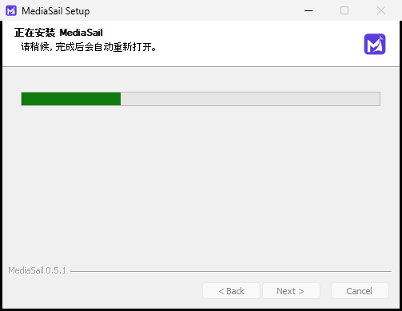

# MediaSail 0.5.1：未发行候选验证记录

**正式版仍为 0.5.0。** Windows 原生本机 0.4.3 → 0.5.0 已完成真实更新、旧程序清理、数据保留和两次重启核验，[本机报告](LOCAL-UPGRADE-2026-10-15.md)。首轮工具环境的旁装来自 MSIX 私有文件及登记视图，不能当作普通 Windows 更新缺陷；没有为此次本机更新额外发行 0.5.1。

本页仅记录 **人为移除安装登记** 的独立鲁棒性候选。0.5.1 保持 GitHub 草稿，未进入正式更新频道。

## 构建与身份

- 相关 Node 测试 39 / 39 通过。候选客户端包含明确传递自身安装目录的实现；NSIS 恢复函数在官方 `customHeader` 阶段展开并成功编译。
- 官方 0.4.3 安装包固定 SHA256、大小均匹配，在临时 GitHub-hosted Windows 正常安装取得程序、卸载器、应用资源身份，未启动软件，身份上传后正常卸载。[身份运行](https://github.com/jerryrenjianxing-sys/MediaSail/actions/runs/38756506224) · [身份记录](evidence/release-identity-0.4.3.json)。
- 候选安装包 273,785,460 字节；源码包 35,233,448 字节。五个资产的 GitHub SHA256 与本地产物一致，9 个历史 Release 资产未改变。[草稿资产核验](evidence/assets-0.5.1.json)，其中 `draft: true`。
- 草稿资产对应程序与安装器实现提交 `703af610668552e2f70652e1eab8bf22df1b380e`；之后的测试脚本修订与本页记录未替换这五个草稿资产。

## 缺少登记的真实候选升级：通过

[运行 38762028988](https://github.com/jerryrenjianxing-sys/MediaSail/actions/runs/38762028988) 使用临时 GitHub-hosted Windows。先正常安装真实 0.4.3 到中文空格自选目录，写入合成资料并退出，保存且核验固定 MediaSail GUID 的当前用户安装／卸载键后只移除这些键，再启动未修改的旧程序生成连接资料。

候选以真实 `/S --updated --force-run` 安装，**不传 `/D`**。正常卸载旧程序，安装并自动启动同一位置的 0.5.1；默认安装目录没有旁装。原位置登记、桌面和开始菜单快捷方式正确，合成画像、配置、素材、成品、分析、日历、平台资料标记、主题、草稿及 Cookie 保留，旧聊天归档通过。原 Node、FFmpeg、额外浏览器移除，业务 Python 和 Playwright 私有 Node 保留。测试最后正常卸载成功。

| 指标 | 实测 |
|---|---:|
| 旧程序 | 5,194,730,188 字节 / 85,326 文件 |
| 候选程序 | 837,922,298 字节 / 8,614 文件 |
| 程序缩减 | 4,356,807,890 字节 |
| 安装开始至自动重开 | 291.226 秒 |
| 安装开始至服务就绪 | 295.957 秒 |

数据目录单独统计；这些时间包含真实旧卸载及安装，不含基线安装、初次启动和候选预下载。不是本机正式更新的测速结果。[完整合成验收记录](evidence/upgrade-candidate-0.5.1.json)。

首次运行 `38758932376` 在快捷方式检查处误报：`WScript.Shell` 读出的 ANSI 路径把中文变成 `?`。随后使用 Electron 原生 Unicode 快捷方式读取，两个目标均为正确中文路径，同一候选安装包全流程通过；没有因此修改产品安装器。

## 文件占用时失败回滚：未验证通过

[运行 38762508538](https://github.com/jerryrenjianxing-sys/MediaSail/actions/runs/38762508538) 只在临时 runner 独占锁住旧 Node 文件，未操作本机程序。脚本观察并取消了原生卸载器重试框，随后在匹配后续 Win32 对话按钮时失败：`Expected one known fixture error button`。

因此 **真实最终退出码、登记回滚、旧文件完整恢复及解锁后升级没有完成核验**，不能声称本轮通过。该轮没有完成正常卸载清理（`cleanedUp: false`）；程序仅位于随后销毁的临时 GitHub runner，未留在本机。[故障尝试原始记录](evidence/upgrade-fault-attempt-0.5.1.json)。较早的 `38758943658` 则因测试脚本未处理重试框而超时，同样不计为通过。

按本次本机任务的最终结论，停止额外候选重跑，保留草稿和未通过状态；未发布 0.5.1，也未修改正式 0.5.0 资产。本页不包含真实账号、登录凭据、私有备份或平台公开发布验收。
