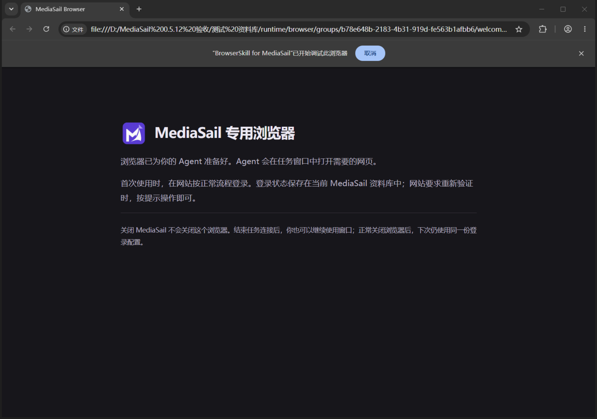
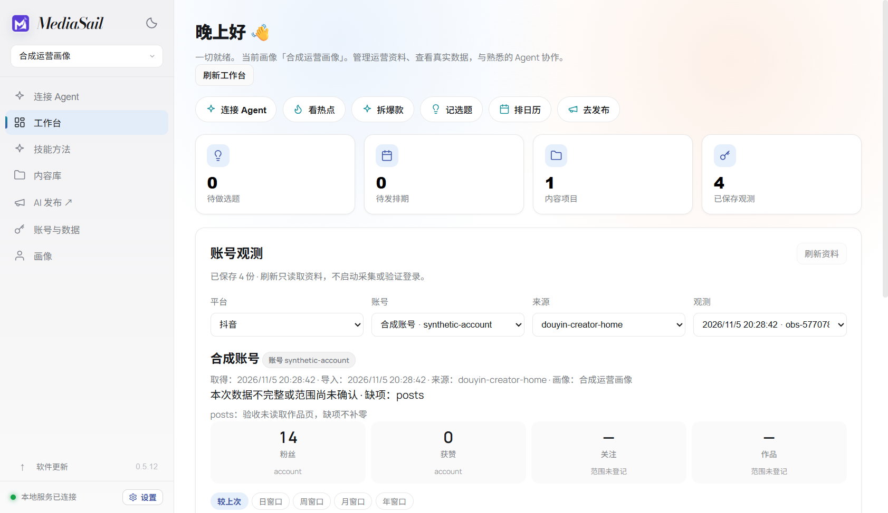
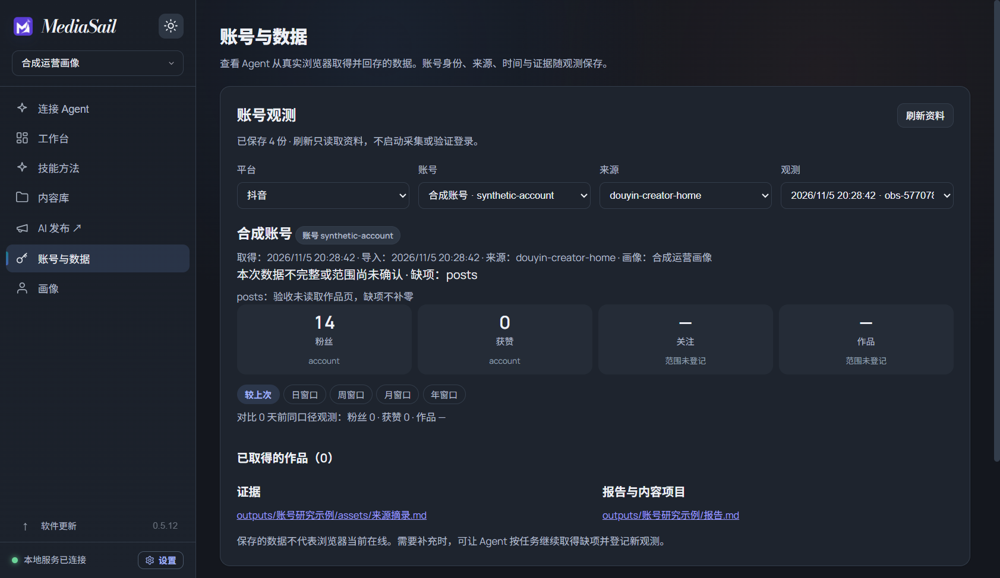
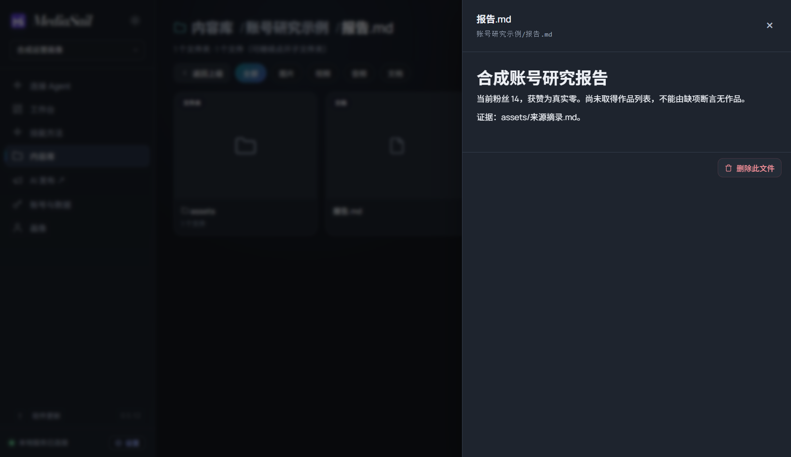
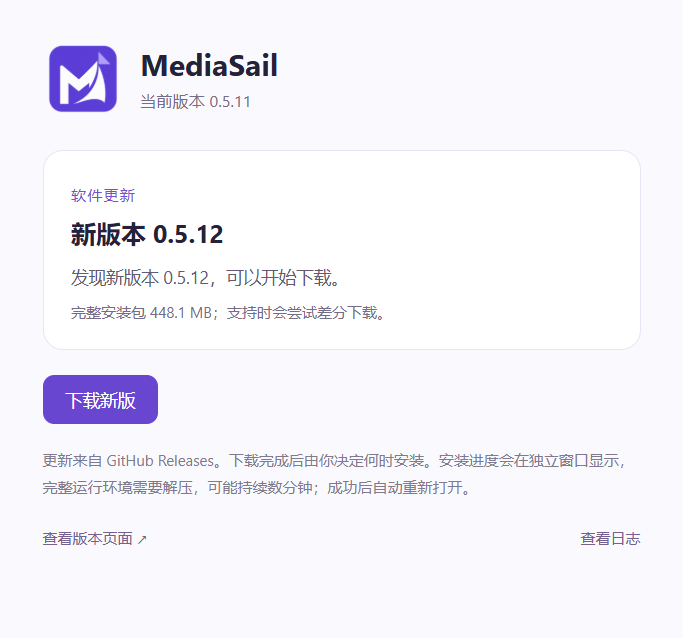

# MediaSail 0.5.12 验证记录

日期：2026-11-05。需求与审查基线见 [SPEC](SPEC-0.5.12.md)。下列测试区分本地实际平台取数、合成测试、真实安装及发行检查；不将任何一个边界的通过当作全部环境兼容。

## 已实现的数据切片

- ObservationStore 共用 CLI/HTTP：登记、查询、读取；缺项与零分开；实际取得时间与导入时间分开；相同编号同内容复用，不同内容冲突；库身份核对；跨进程串行、落盘和同目录原子提交。
- 损坏记录保留，列表报告错误并显示其他有效记录；失败提交不留下半份记录。嵌套缺项、证据引用和覆盖范围的格式也会检查，避免坏数据使界面崩溃。
- 外部增长先检查平台、稳定账号及身份依据、业务来源、字段标签/单位/窗口/范围，复用原公式，不伪造旧 verified，不写旧登录标记或旧 JSONL。
- 工作台及“账号与数据”优先显示已保存观测；旧工具在折叠区。打开、恢复和筛选不启动旧校验/采集，平台切换只是选平台，采集有独立按钮。
- 刷新保留账号与观测选择。所选记录被删除时保留不可用选项，不自动显示另一账号；读取失败说明原因并保留当前资料。
- 本地 helper 支持 observations register/list/show。Skill 与接口资料补充回存、证据、报告登记、真实浏览器与旧工具登录的关系。

## 执行证据

| 边界 | 结果与范围 |
| --- | --- |
| 实际 CLI、HTTP | 专项 12 个测试通过；涵盖缺项、零、重复、冲突、损坏原件及元数据/NaN/超大整数、额外指标保留、10 个独立进程竞争、原子提交失败、跨库误投、嵌套坏数据、离线 helper、口径与取得时间。不是平台联网测试 |
| 原业务计算 | account_stats 原离线 selftest 通过；原增长与已知账号测试继续通过，公式未改 |
| 整体源码检查 | 最终 GitHub Node 126 项、Python 125 项、前端类型及构建、45 个接口资料、Easel/BrowserSkill 固定补丁复现通过；本机较早完整轮为 Python 122 项及 1 项 Windows 链接权限跳过，后增加源码输入校验 3 项 |
| 可见界面 | scripts/verify-observation-ui.cjs 使用合成网络边界通过：未登录显示外部观测、保持账号、删除后不换号、503 原因与资料保留、打开原生区域/窗口恢复不校验、不采集、浅深色截图。网络模拟不代替存储测试 |
| 独立外部 Agent | 从短 MD → 当前发现信息 → 完整 Skill → helper/HTTP；未读产品源码，完成画像查阅、双观测登记、增长读取、画像带 revision 更新、报告及成品登记；总耗时 510.805 秒，含研究、纠错和核对，不作为产品速度承诺 |
| 原生界面读回与重启 | 开发 Electron + 当前真实业务服务在隔离中文空格路径资料库中读取 Agent 的两份观测与报告；正常关闭并复用同库重开后仍显示。不是 NSIS 安装升级验收 |

合成业务增长为粉丝 +4、获赞 +10、公开作品 +1，实际基线相隔两天。原公式的 day 窗口选不晚于一天前的最近样本，因此也返回两天差值；界面用“日窗口”等名称并注明实际间隔，避免宣称严格昨日差值。

两轴审查发现的坏记录元数据未隔离、未知指标静默忽略均已完成红绿回归与独立复核；另补超大整数导致数值检查溢出的同根边界。额外业务输入现在回存 extensions 并给回执说明，纳入哈希与冲突核对。详见[数据切片审查](REVIEW-0.5.12-data-core.md)。

独立 Agent 首次把 identityEvidence 写成对象，接口拒绝；它根据明确错误改成列表后继续，无需人工补抓。已补充列表示例和 OpenAPI 相关字段。首次原生读回脚本把含账号徽章的标题当纯文字精确匹配，等待失败；改用标题角色匹配后，同库重启读回通过，未改动业务记录来适配测试。

合成材料与截图保留于本机构建工作区 `.test-data/观测接入验收 1793853872248/`，不包含真实平台账号。两份观测编号分别为 `obs-a51a4de0952080164374eb348a6c41f9241e3fbc31d85ac94cbe3150537bbc6b`、`obs-633bddd45d5e5616338a244c2dc54e592f22c51e81986cb5c10404359225ed89`；画像回读 revision 为 `7dcf298570681c090c34e389f91fc451be22189e73db1e98b42696ea72e430f8`。

## 历史候选：agent-browser（已停止采用）

以下为先前方案的调查，不是当前发行门槛。用户已将个人浏览器调试路线改为自动配置专用浏览器；相关失败过程保留。

- 官方 Windows x64 EXE 为 18,248,192 字节，本地 SHA-256 已核对为 `c2eadee7b67e326dfff02d5dd51a16ce7673eb165699d134b3ea5f05b4a7a9d0`。不依赖 npm 启动。
- 隔离命令 PATH 仅含 Windows 系统目录时，`--version` 成功，但首次 `skills get core` 报缺少说明目录。随后从固定提交 `d52a5e90c372ec4710c69adc3837ac14bbd852aa` 准备 skill-data 及许可共 29 个文件（239,626 字节），逐个核对 Git blob SHA-1 并记录 SHA-256，设置独立 `AGENT_BROWSER_SKILLS_DIR` 后读取成功。不是全局安装 Skill。
- 离线检查确认命令环境找不到全局 Node/Python，原生版本与匹配说明读取通过；尚不证明浏览器连接和业务取数通过。
- 当前电脑操作工具对 `chrome://inspect/#remote-debugging` 返回原生协议被 URL 策略阻止，并明确禁止间接执行、改换渠道或原始 CDP 绕过；没有采取这些替代动作。
- 用户已选择亲自完成浏览器原生授权后继续。最近一次只读检查两款浏览器尚无 `DevToolsActivePort`，因此未连接、未取数、未把 candidate 纳入正式安装包。待实际授权就绪再发起连接请求，用户选择继续不等同于授权已经完成。

本地候选与匹配说明校验记录留在 `.test-data/browser-native-gate-0512/`，无真实账号取数结果。当前操作未覆盖日常安装或资料库。

## 历史候选：Playwright CLI（已停止采用）

固定研究及源码依据见 [备用工具](research/2026-11-05-browser-fallbacks.md)、[协作讨论](research/2026-11-05-browser-meeting.md)。当前仅在忽略的隔离目录准备候选依赖，未把备用组件接入发行包。

- 已用业务 Playwright 的私有 Node v24.21.0 执行 CLI 0.1.23，版本与 attach 帮助成功。CLI 依赖 Playwright/Core 1.65.0-alpha-2026-10-30；与原业务 Playwright 1.63.0 分开。
- 验收命令的 PATH 只含 Windows 系统目录与 PowerShell，不使用全局 Node/npm；未下载额外 Chromium。
- Edge 的 `attach --extension=msedge`、Chrome 的 `attach --extension=chrome` 均在扩展发现阶段返回“Playwright Extension not found”。这说明缺少配对前置条件，不能据此宣称版本不兼容，也不能把现有 Agent 的专用扩展当官方扩展验收。
- 当前电脑操作工具对扩展商店请求返回 Not allowed；没有绕过限制、修改浏览器策略、安装非商店扩展或打开空白账号配置兜底。浏览器侧扩展安装确认尚待完成。
- 先前复用当前 Agent 已具备的 Edge 能力只读取到真实抖音主页与创作者概览，未扫码、未公开发布；这证明已有工具可复用，不等于备用组件通过，也不等于真实数据已完成本轮回存验收。公开研究资料不含账号或数值。

上述个人双浏览器方案已被现行 SPEC 替换，不再要求用户手动安装扩展或配置调试。

## 现行专用浏览器候选：已执行

- 固定 ungoogled-chromium `156.0.8078.73-1.1` 原 ZIP，SHA-256 与 SPEC 一致。最终 BrowserSkill 为 Rust 1.99.1、`x86_64-pc-windows-gnullvm`、LLVM-MinGW 20261104 UCRT 静态开源运行代码构建，EXE SHA-256 `5cd02e7aeb2a8ff2fe1326af41140d84f979a2d80c76597b9276eb02dc559694`；实际链接输入与 21 个系统 DLL/API 导入核验通过，不复制 SDK/MSVC 静态 CRT、不要求额外 VC Runtime。早期 MSVC 候选不发行。扩展使用固定公开密钥身份、同组 loopback nonce，CLI/扩展构建标识一致。
- 原候选与适配构建分别自动连接，真实合成页面输入/点击、表格 CSV 导出、截图通过。H.264/AAC CC0 样本实际播放，readyState=4、960×540、播放时间推进、无媒体错误。不是只检查 canPlayType。
- 正式 PowerShell 5.1 入口在无全局 Node/Python 的子进程环境中完成准备、可见浏览器启动及连接；准备与状态不启动浏览器。中文空格路径通过。最初深路径暴露 Windows PowerShell/.NET 长度限制：缩短临时目录，并在超范围时提前明确报错，保留原库，不声称支持无限路径。
- 首次真实扫码由用户在新候选配置完成。只读取抖音创作者首页，保存六项有明确统计周期的指标、账号显示编号依据、截图与摘录；累计指标、周期指标及未读作品总数分开。
- 用现有 CLI 登记、HTTP 读回及重复提交核对，真实零和缺项均保留；原生 MediaSail 工作台、账号与数据页、报告项目及 Markdown 预览全部读回通过。真实资料只在本机独立验收库，不进入公开包。
- disconnect 结束任务后浏览器仍在；向本轮实际创建的浏览器发送正常关闭请求，等待其退出，没有强杀。重新 connect 后同账号仍已登录，未复制 Cookie、未二次扫码。
- 已复现 daemon 结束后显式 connect 无法恢复的失败，补成只恢复原组/原端口的 daemon；不启动另一浏览器。run 不自动恢复或重放。其他已完成红绿：helper 参数边界、PowerShell 管道 JSON、发现镜像误报循环；实际启动命令结束后浏览器和 daemon 仍运行。
- 完整窗口截图确认无 CfT “仅用于测试”横幅，正常“BrowserSkill for MediaSail 已开始调试此浏览器”及取消按钮保留。原生窗口绑定工具对未注册 Chromium 报 owner=Chrome 的绑定错误；截图改由独立 Electron 开发测试的 desktopCapturer 获取任务自建 welcome 窗口，不修改浏览器策略。
- 许可调查已对实际 credits 与对应源文件、137 个 UGC/Windows 补丁、域名替换及裁剪输入进行核对；没有宣称全量 Chromium GN 或重编译通过。最终许可原件、对应源码资产与发行核验仍须完成，详见[调查记录](research/2026-11-05-browser-candidate-license-audit.md)。
- 最终 GNU 构建重新自动连接原专用浏览器配置、读取原账号登录保持通过；业务软件退出后仍能使用原回执。实际 WebSocket 连接分别验证错误组 nonce 为 403、错误扩展 Origin 为 403、同组合法握手为 101，未公开 nonce 或调试端点。
- 隔离 mini-NSIS 覆盖 D3D 组件许可：未同意或错误哈希的 `/S` 在安装前退出 3；明确提供当前原件 SHA 同意参数后成功，相同条款记忆后不重复询问。可见页面默认不勾选、下一步禁用，正常取消退出 1 且未安装。只限制微软 D3D DLL，不改变其他开源部分的修改/调试权利。正式完整安装器另验。
- 最终 GitHub 源码检查通过 Node 126 项、Python 125 项、前端构建、45 路径接口资料及两个上游补丁重放。源码包输入校验包含 3 个实际 CLI 红绿测试，拒绝缺失、空目录和损坏依赖源码。最终真实输入包逐项核对 226 个 Rust 源归档；正确输入也单独实际执行，不仅运行负向测试。[运行记录](https://github.com/jerryrenjianxing-sys/MediaSail/actions/runs/42022789218)。
- 两轴复审发现的自动 SkillSync、重复 daemon 核验、验收清理失败挂起及源码归档漏项已经修复。Standards 与 Spec 当前无剩余已确认问题；不以审查代替安装升级。
- 最终包的原生程序在新隔离库实测：真实业务服务登记合成观测、工作台读回、账号页亮暗切换、项目报告打开及 Markdown 预览通过。截图显示版本 0.5.12，不使用早期界面照片代替。此前截图脚本把控制台主题按钮和未提供 description 的报告链接认错，修正定位后实际读回通过；没有修改业务资料来迁就断言。
- 最终资源缓存 140 个校验文件与 manifest 共 473,007,063 字节，首次校验、解压、原子准备实测 6.164 秒；在用旧组仍保持原缓存，新连接不覆盖它。正常关闭后切到最终缓存、重开真实抖音主页，同一账号仍已登录。
- 原 daemon 结束后 `run` 明确失败，没有自动恢复；用本轮自建 TCP 监听占据原私有端口，显式 connect 被拒绝；释放后显式 connect 恢复原浏览器 PID、资料目录和端口，未换浏览器。测试监听只清理自己的 socket；重新只读导航后台后核对同账号保持。

## 真实安装验收过程

第一轮 [42023183357](https://github.com/jerryrenjianxing-sys/MediaSail/actions/runs/42023183357)：真实 0.5.11→0.5.12 NSIS 覆盖安装退出 0（296.111 秒）；原安装位置/登记、34 份既有合成文件、22 份旧登录分区文件、画像、项目扩展字段、用户修改的方法/Skill、资料库选择及当前更新缓存核对通过，连续两次正常重启通过。随后 browser connect 被 runner 的外层 Job 拒绝 CREATE_BREAKAWAY（0x5），整轮明确失败，未因此发布。

第二轮 [42025583948](https://github.com/jerryrenjianxing-sys/MediaSail/actions/runs/42025583948) 全部通过，保留原候选安装包 SHA-256 `e79667d4a02315a1b20068593ec8a62b8de1c82ddf0e17ad89e21b5af7e910a7`。仅调整测试命令宿主：创建测试自有、允许 breakaway 的内层 Job；外层 runner Job 不变，浏览器仍受它管理。没有放宽实际操作、PID/缓存、原回执及同版覆盖断言；不将这一环境适配宣称为所有禁止 breakaway 的宿主均兼容。

| 真实安装步骤 | 结果 |
| --- | --- |
| 原版 0.5.11 安装 | 退出 0，130.828 秒 |
| 0.5.11→0.5.12 | 退出 0，188.485 秒；不指定新位置，仍在原中文空格目录，登记一致、无旁装 |
| 原数据与两次正常重启 | 34 份合成原文件及旧登录分区字节保持；画像、项目、扩展字段、自定义方法/Skill、选库和当前安装缓存保留；两次正常重启通过 |
| 软件退出后工具连接 | 无全局 Node/Python 路径，候选入口实际自动准备和连接；合成页面输入、Cookie、localStorage 由原回执读回 |
| 浏览器运行中同版覆盖 | NSIS 退出 0，112.707 秒；相同 browser PID、缓存与原 sessionRef 仍能读取原页面和持久标记，没有重新 connect |
| 重装后再退出 | 原回执继续操作通过；最后解除本任务、正常关闭浏览器并停止私有 daemon，清理失败会令总体失败，本轮清理通过 |

这些是 GitHub 临时 Windows 机器的安装阶段耗时，不含网络下载，也不承诺其他电脑相同速度。组件许可使用明确版本哈希同意参数；`/S` 本身不代表同意。正常用户第一次安装会看到组件许可页面，浏览器连接无需商店或调试设置。

真实账号扫描、取数、正常关闭重开保持分别在本机独立验收库完成；云端使用合成 Cookie/localStorage，不把合成登录材料说成真实平台登录。无公开发布内容。测试本机浏览器均已正常关闭，私有 daemon 已停止；登录配置及证据留在独立验收库，日常 `D:\mediasail` 和日常资料库未改动。

## 发行文件与空间

| 项目 | 实测逻辑字节 | 说明 |
| --- | ---: | --- |
| Windows x64 完整安装包 | 469,889,821 | 约 470 MB，含浏览器及工具；比 0.5.11 的 263,032,260 字节增加约 207 MB |
| 程序文件 | 1,078,364,313 | 包内 Windows 程序、业务运行环境、资源及浏览器发行归档 |
| 首次准备后的工具缓存 | 473,007,063 | 141 个文件（含清单）；不同历史缓存按计划保留，不自动清理 |
| 本次已登录浏览器配置示例 | 87,497,257 | 随网站和使用增长，不是固定要求；实际账号资料不公开 |
| 更新组件当前安装包缓存 | 469,889,821 | 真实 NSIS 安装已核对版本、大小与哈希；另计于资料库，不包含在上述程序目录 |

开发用 Chromium 对应源码原件 4,422,774,264 字节，分三卷在同一 Release 提供，另有 233,899,482 字节构建材料/BrowserSkill/依赖源码 ZIP。它们只供开发者，不进入普通用户的安装或首次工具准备。逐项校验、ZIP CRC、137 个补丁准备及 226 份 Rust 源归档核对通过；未执行完整 Chromium 重编译。11 个草稿资产（含校验文件）已核对 GitHub 服务器 SHA-256/大小，正式发布前对最终源码包与校验文件再核对。

主要执行记录：[本地浏览器脱敏证据](evidence/browser-0.5.12.json)、[真实安装结果](evidence/upgrade-0.5.12.json)、[活会话覆盖结果](evidence/managed-browser-upgrade-0.5.12.json)。Standards 与 Spec 的审查结论分别见 [规范轴](REVIEW-0.5.12-managed-standards.md) 和 [需求轴](REVIEW-0.5.12-managed-spec.md)，当前均无剩余已确认问题。

## 页面截图与范围

以下为正式包及合成资料，专用浏览器保留正常调试控制提示，没有 CfT 测试发行横幅。真实账号页面只在本机私有证据中。

## 正式发布后核对

[v0.5.12](https://github.com/jerryrenjianxing-sys/MediaSail/releases/tag/v0.5.12) 已发布为正式最新版，标签对应源码提交 `c4b12d6c6b3b1d45288c5d574f259abdfc9235a7`。11 个草稿资产经最终逐项云端 digest/大小核对后发布；原安装包与真实升级验收哈希相同。历史 Release 及 0.5.1 草稿保留。最终主分支 [源码检查](https://github.com/jerryrenjianxing-sys/MediaSail/actions/runs/42027572418) 全部通过。

隔离的原版 0.5.11 使用原 electron-updater GitHub 源，从设置实际检查得到 `available / 0.5.12`；本版得到 `current / 0.5.12`。两边 transferred=0，未请求下载或安装，没有更换数据源。[旧版回执](evidence/content-update-0.5.11-to-0.5.12.json) · [新版回执](evidence/content-update-0.5.12-to-0.5.12.json) · [发行资产核验](evidence/release-0.5.12.json)。

这些是发布后补充的审计记录，已验收安装包和标签源码归档保持原样。本记录不覆盖所有社交平台的实时状态；网站权限、重新登录及其他 Agent 自带浏览器工具仍以实际情况为准。
